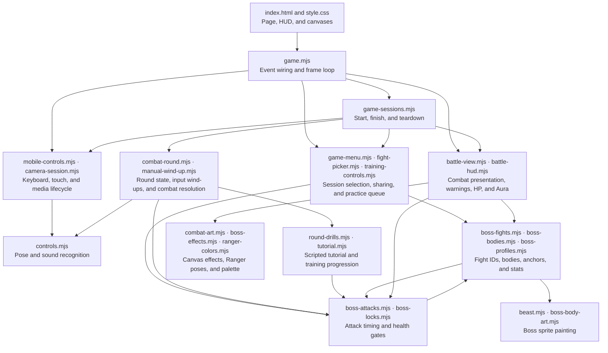

# Rift Ranger architecture

Rift Ranger is a static browser game. GitHub Pages serves the HTML, CSS, art, and native JavaScript modules. The browser keeps the active round in memory. Camera and microphone input are processed locally. The Ranger's suit colour is saved in browser storage.

## Modules

Arrows point from a consumer to the modules it uses. Each box groups files that work on the same part of the game.

The two arrows between fight data and rules summarize different file dependencies. `boss-fights.mjs` uses the move definitions and lock helpers, while `boss-attacks.mjs` reads body stat profiles. These imports do not form a cycle between individual files.

## A combat frame

1. Keyboard and touch handlers translate physical input into named actions such as Slash and held Block. The round tracks their wind-up deadlines and cancels early releases. The frame loop also samples the camera and microphone, which report gestures, sustained sound, and brief firing cues.
2. `game.mjs` calls the active round's `step()`. The round owns HP, Aura, banked Powerwaves, and status state. It resolves actions using the boss scheduler and lock helpers.
3. `game.mjs` passes the result to the battle view, advances any pending training drill, and requests the next frame. The view updates the HUD and renders the Ranger pose, the boss's attachment points, and current effects. Combat reports immediate HUD or effect changes through feedback callbacks. A displayed HP bar is a view of round state, so editing the DOM does not alter combat.

The round and its animations use the browser's monotonic clock. Move tells have their own durations. Boss profile modifiers change recovery gaps, with the scheduler reserving time for the full tell. The camera and microphone may sample at different rates, so Aura charge from audio uses the interval between samples.

## Session rules

`game-menu.mjs` turns the player's session and opponent selections into a start request. `game-sessions.mjs` creates the round, initializes its view, and starts the frame loop. At the end it stops the loop and releases devices and held inputs before showing the appropriate result or start menu.

| Session | Boss attacks | Health and locks |
| --- | --- | --- |
| Battle | The scheduler rotates the moves from the configured fight. | Body stats, passive recovery, and the fight's ordered locks apply. |
| Tutorial | The active lesson controls the next attack and which Ranger actions it accepts. | The lesson controls whether damage or a lock applies. |
| Training | The player queues up to three moves. The round runs a snapshot in order, using the same tells and strike resolvers as battle. | Both fighters take real damage. The boss has no passive recovery or locks, and the run ends when either fighter reaches zero HP. |

A fight ID stores the body, implemented moveset, and lock order. The parser validates the lock order against the chosen body's profile. Training keeps the editable queue in the panel and consumes its own snapshot so the same lineup can run again.

## Where to make a change

| Change | Start here |
| --- | --- |
| New boss move | `boss-attacks.mjs` for the tell, timing, and outcome. Reuse an existing resolver in `combat-round.mjs` where its rules fit. Add canvas feedback in `boss-effects.mjs`. |
| New boss body | `boss-bodies.mjs` for the roster entry, `boss-body-art.mjs` for its paint routine, and `boss-profiles.mjs` for its stats. Normalize effect anchors in the sprite's own coordinate system. |
| New input or binding | `mobile-controls.mjs` for keyboard and touch, or `controls.mjs` for camera and microphone detection. Route the result through the existing round actions. |
| Status display or layout | `battle-view.mjs` and `battle-hud.mjs` for presentation, and `style.css` for placement. Keep the rule that changes the status in the round. |
| Suit palette or Aura visuals | `ranger-colors.mjs` for suit colours and `combat-art.mjs` for the separate Aura colours and rendered poses. |

Run `npm test` for combat rules, fight IDs, and input tests. Run `npm run test:browser` for Firefox flows, including Training Mode and suit colour persistence. Setup instructions are in the [README](README.md#working-on-the-game).
